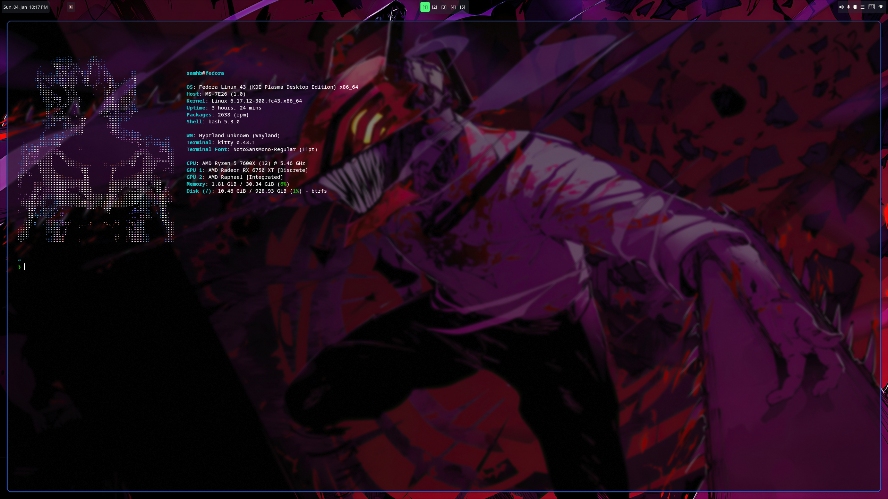
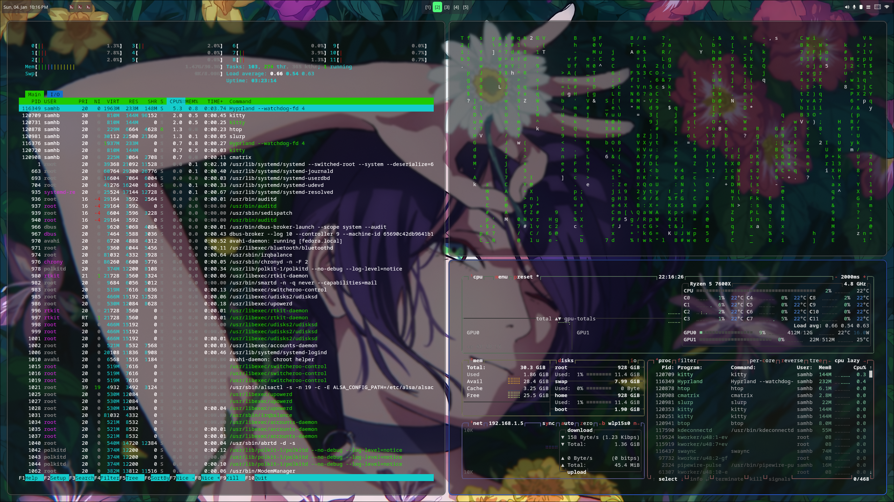
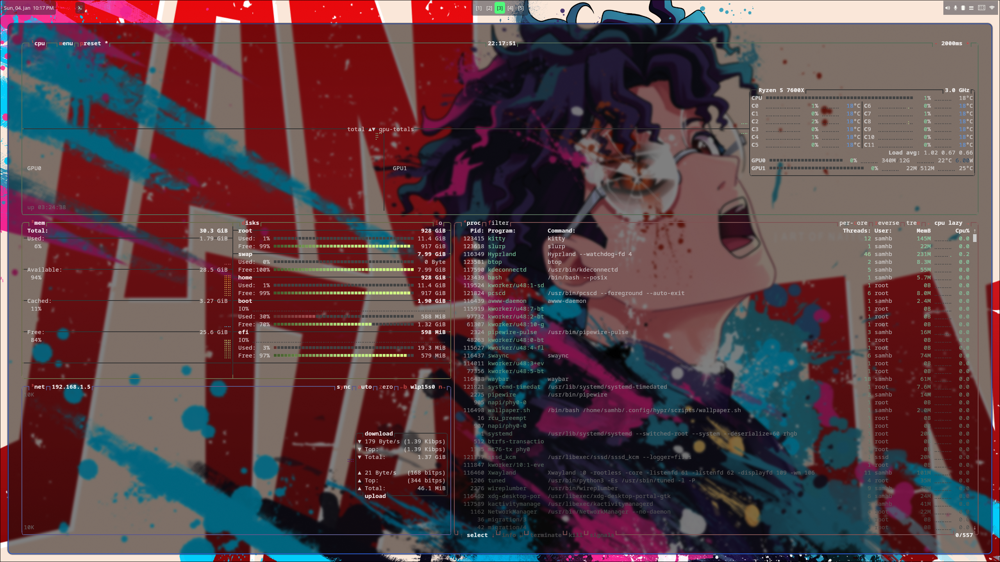
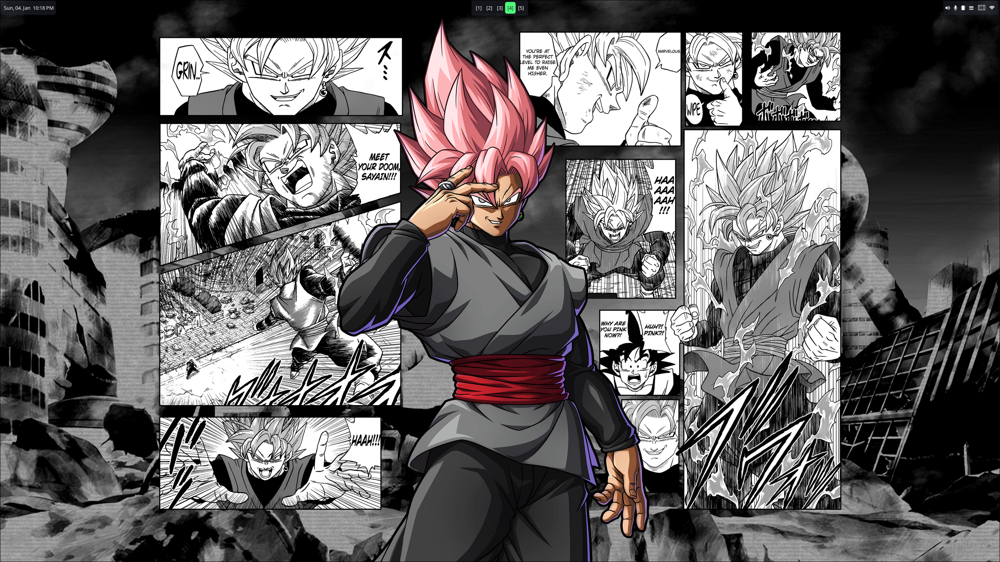
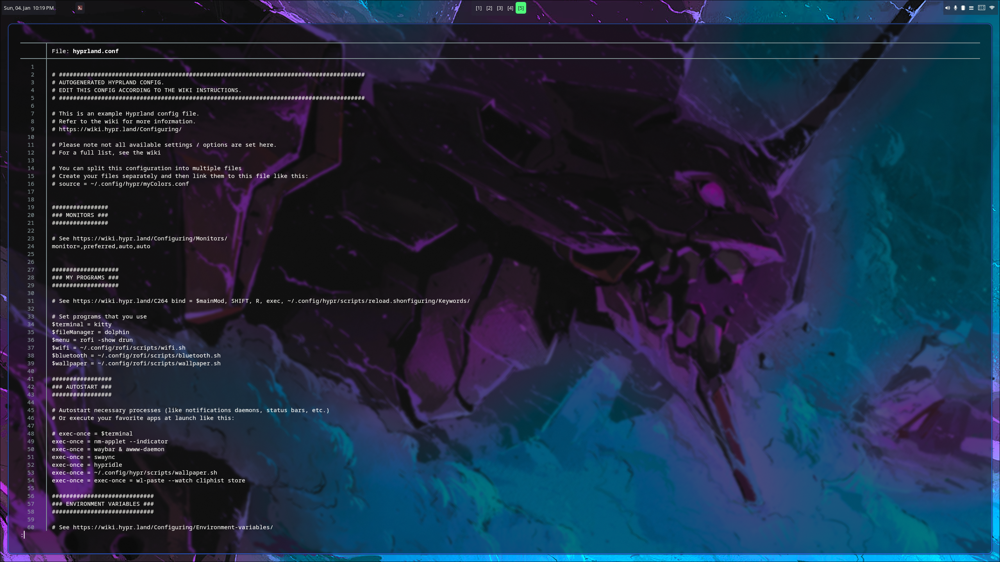
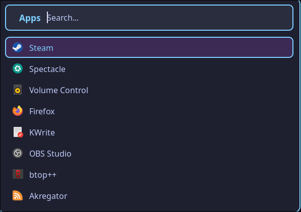
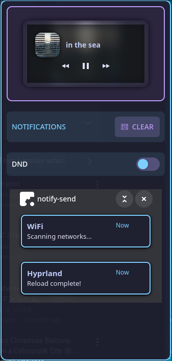

# Samuel's Hyprland dotfiles

Hyprland desktop setup on Fedora Linux, styled with Catppuccin Mocha. Built for an AMD Ryzen 5 7600X and Radeon RX 6750 XT driving a 144Hz 1440p display.

> [!NOTE]
> Configured for Fedora, but works on any modern Wayland distribution with minor path adjustments. Update wallpaper paths in `~/.config/hypr/scripts/wallpaper.sh` to match your local files.

## Repository structure

```
~/dotfiles/
├── .config/
│   ├── btop/
│   │   ├── btop.conf             # Resource monitor config
│   │   └── themes/
│   │       └── catppuccin_mocha.theme # Catppuccin Mocha theme
│   ├── fastfetch/
│   │   ├── config.jsonc          # System info display
│   │   └── my-logo.txt           # Custom ASCII logo
│   ├── hypr/
│   │   ├── conf/                 # Modular configuration
│   │   │   ├── animations.conf   # Smooth slidefade transitions
│   │   │   ├── autostart.conf    # Background daemons & polkit agent
│   │   │   ├── env.conf          # Wayland and toolkit variables
│   │   │   ├── input.conf        # Keyboard, mouse, and focus
│   │   │   ├── keybinds.conf     # Hotkeys and layout bindings
│   │   │   ├── layouts.conf      # Dwindle layout settings
│   │   │   ├── look_and_feel.conf# Gaps, borders, shadows, and blur
│   │   │   ├── monitors.conf     # Resolution, refresh rate, and scale
│   │   │   ├── programs.conf     # Default terminal, file manager, and launcher
│   │   │   └── windowrules.conf  # Opacity, floating, and window placement
│   │   ├── hypridle.conf         # Screen dimming and sleep triggers
│   │   ├── hyprland.conf         # Root entry point (sources conf/*.conf)
│   │   ├── hyprlock.conf         # Lock screen with frosted blur
│   │   └── scripts/
│   │       ├── reload.sh         # Reload compositor, bar, and notifications
│   │       └── wallpaper.sh      # Per-workspace wallpaper listener
│   ├── kitty/
│   │   └── kitty.conf            # GPU terminal with 144Hz input tuning
│   ├── rofi/
│   │   ├── config.rasi           # Application launcher
│   │   ├── scripts/
│   │   │   ├── bluetooth.sh      # Bluetooth picker
│   │   │   ├── clipboard_history.sh # Clipboard history (cliphist)
│   │   │   ├── powermenu.sh      # Lock, logout, reboot, and shutdown
│   │   │   ├── wallpaper.sh      # Wallpaper browser
│   │   │   └── wifi.sh           # Network selector
│   │   └── themes/
│   │       ├── clipboard.rasi    # Catppuccin Mocha clipboard theme
│   │       └── current.rasi      # Catppuccin Mocha menu theme
│   ├── starship.toml             # Catppuccin Mocha shell prompt
│   ├── swaync/
│   │   ├── config.json           # Notification daemon and control center
│   │   └── style.css             # Notification panel styles
│   └── waybar/
│       ├── config.jsonc          # Three-island floating status bar
│       ├── style.css             # Floating pill styles
│       └── scripts/
│           └── launch.sh         # Reload status bar
├── assets/                       # Screenshots and demo media
├── scripts/
│   ├── apply-system-optimizations.sh # DNF, tuned profile, and service tweaks
│   └── install-symlinks.sh       # Idempotent symlink installer for ~/.config
└── README.md
```

<div align="center">

https://github.com/user-attachments/assets/e41b7de6-2717-4371-a81f-c4a124757f12
  
</div>

<details>
  <summary><strong>Screenshots</strong></summary>

<div align="center">

  <b>Workspace 1</b><br>
  <br><br>

  <b>Workspace 2</b><br>
  <br><br>

  <b>Workspace 3</b><br>
  <br><br>

  <b>Workspace 4</b><br>
  <br><br>

  <b>Workspace 5</b><br>
  <br><br>

  <b>Rofi launcher</b><br>
  <br><br>

  <b>SwayNC panel</b><br>
  <br><br>

  <b>Waybar layout</b><br>
  
    
</div>

</details>

## Core components

| Tool | Role |
|---|---|
| [Hyprland](https://github.com/hyprwm/Hyprland) | Wayland tiling compositor |
| [Waybar](https://github.com/Alexays/Waybar) | Floating status bar with workspace indicators |
| [awww](https://codeberg.org/LGFae/awww) | Wallpaper daemon running 144 FPS bezier transitions |
| [SwayNC](https://github.com/ErikReider/SwayNotificationCenter) | Notification center and quick settings |
| [hyprlock](https://github.com/hyprwm/hyprlock) | Screen locker with screenshot blur |
| [hypridle](https://github.com/hyprwm/hypridle) | Idle listener and sleep controller |
| [Kitty](https://github.com/kovidgoyal/kitty) | Terminal emulator running 6ms refresh and 1ms input latency |
| [Rofi](https://github.com/davatorium/rofi) | App launcher, power menu, and picker scripts |
| [Fastfetch](https://github.com/fastfetch-cli/fastfetch) | System information summary |

## Keybindings

The main modifier key is `SUPER`.

| Keybind | Action |
|---|---|
| `SUPER + Return` | Open terminal (Kitty) |
| `SUPER + Q` | Close active window |
| `SUPER + D` | Open application launcher (Rofi) |
| `SUPER + M` or `SUPER + Escape` | Open power menu (lock, logout, reboot, power off) |
| `SUPER + F` | Open file manager (Dolphin) |
| `SUPER + SHIFT + F` | Toggle fullscreen |
| `SUPER + V` or `SUPER + Space` | Toggle floating / tiling window mode |
| `SUPER + P` | Toggle pseudotile |
| `SUPER + J` | Toggle split direction |
| `SUPER + W` | Launch Firefox |
| `SUPER + C` | Launch VS Code |
| `SUPER + G` | Open Git client (Lazygit, floating) |
| `SUPER + SHIFT + Escape` | Open system monitor (Btop, floating) |
| `SUPER + L` | Lock screen (hyprlock) |
| `SUPER + N` | Open notification panel (SwayNC) |
| `SUPER + SHIFT + S` | Area screenshot to clipboard and disk (grimblast) |
| `SUPER + SHIFT + R` | Reload Hyprland, Waybar, and SwayNC |
| `SUPER + R` | Reload Waybar |
| `SUPER + A` | Trigger workspace wallpaper refresh |
| `SUPER + SHIFT + A` | Open wallpaper selector menu |
| `SUPER + SHIFT + V` | Open clipboard history |
| `SUPER + SHIFT + W` | Open Wi-Fi network selector |
| `SUPER + SHIFT + B` | Open Bluetooth device manager |
| `SUPER + 1-9, 0` | Switch to workspace 1 to 10 |
| `SUPER + SHIFT + 1-9, 0` | Move active window to workspace 1 to 10 |
| `SUPER + Left / Right / Up / Down` | Move window focus |
| `SUPER + Left Click + Drag` | Move floating window |
| `SUPER + Right Click + Drag` | Resize window |

## Installation & setup

To link all configuration directories (`hypr`, `waybar`, `kitty`, `rofi`, `swaync`, `fastfetch`, `btop`, `starship.toml`) to `~/.config/`:

```bash
./scripts/install-symlinks.sh
```

Existing conflicting configuration files or directories will be safely backed up automatically with a timestamp before creating the symlinks.

## System optimizations

An automated tuning script is included in `scripts/apply-system-optimizations.sh`. It configures:

- DNF parallel downloads (capped at 2), fastest mirror selection, and default yes prompts.
- Tuned power profile set to `desktop` for responsive CPU governor scaling.
- Disables `NetworkManager-wait-online.service` to trim cold boot time.
- Inotify user watch limit raised to 524,288 for large development projects.
- Hardware video decode via RPM Fusion `mesa-va-drivers-freeworld` on AMD Radeon GPUs.
- Disables idle background daemons (`ModemManager`, `thermald`, `rsyslog`, `abrtd`, and `lvm2-monitor`).
- Installs modern developer CLI tools (`fzf`, `zoxide`, `eza`, `git-delta`, `duf`).

To apply these tweaks:

```bash
sudo ./scripts/apply-system-optimizations.sh
```

## Verification

Run `bash tests/run.sh` for shell syntax and isolated regression checks. Tests use
mock commands and temporary homes; they do not alter the running desktop.

The workspace wallpaper listener has one owner per Hyprland session. `SUPER+A`
runs `wallpaper.sh --once` to refresh without creating another listener. Workspaces
6–10 retain the last wallpaper. Missing images and daemon failures go to stderr.

Rofi Wi-Fi selection opens Kitty with NetworkManager's `nmcli --ask` prompt;
saved credentials and authentication remain NetworkManager's responsibility.
Clipboard history supports Enter to copy, Delete to delete the selected entry,
and Ctrl+Delete to clear history after confirmation. Escape leaves the clipboard
and history alone. Wallpaper selection displays relative paths and handles
punctuation and duplicate filenames without regex matching.
